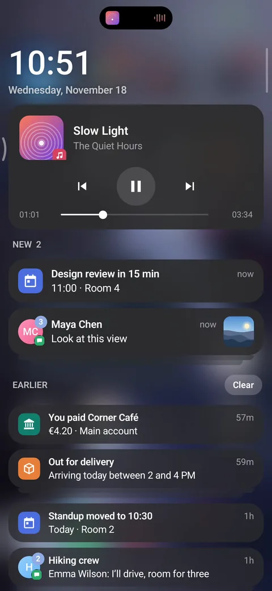
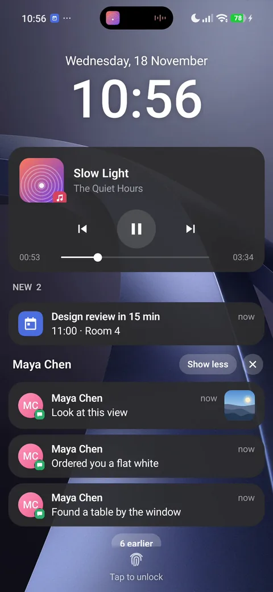
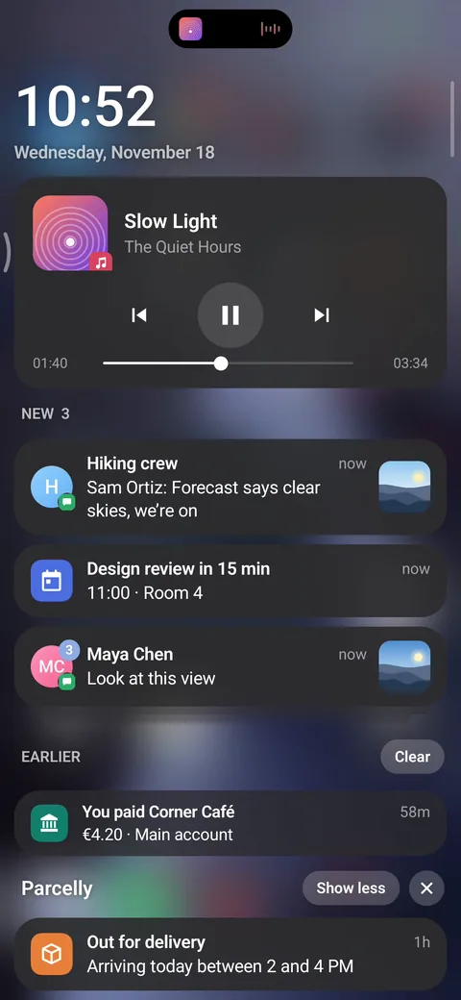
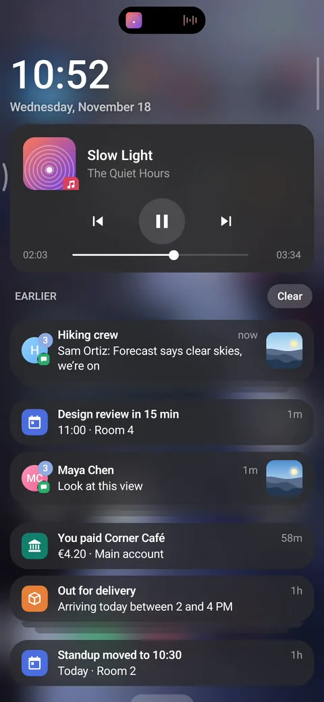
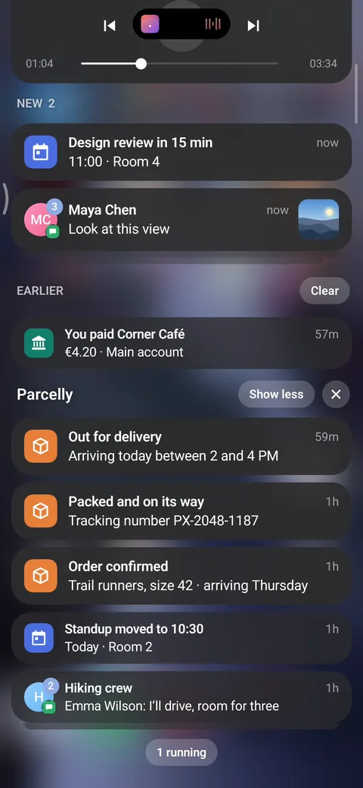
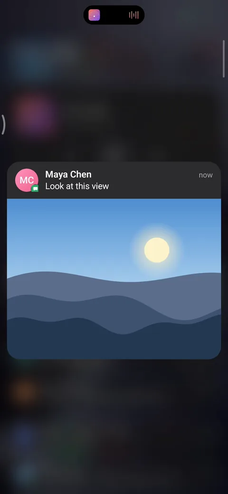

# Chronotif

See what happened while you were away, without clearing everything to feel caught up.

Chronotif is a free, open-source notification panel and optional lock-screen view for
Android. It shows notifications newest first, keeps what arrived since your last check
under New, and folds what you've already checked into Earlier. Those notifications
stay accessible without competing for the same attention.

**Android 11 or newer.** No accounts, ads, or analytics. Your notifications stay on your phone.

[Download stable](https://github.com/nagarete/chronotif/releases/latest) ·
[Nightly builds](https://github.com/nagarete/chronotif/releases?q=nightly&expanded=true) ·
[Website & interactive demo](https://chronotif.com) ·
[Setup help](docs/guide.md#install)


https://github.com/user-attachments/assets/9d86370d-1485-4374-9aa4-5f64a284c57f


<table align="center">
  <tr>
    <td align="center" valign="top" width="33%">
      <br>
      <b>The panel</b><br><sub>New since your last check, then Earlier, newest first.</sub>
    </td>
    <td align="center" valign="top" width="33%">
      <br>
      <b>The lock screen</b><br><sub>What's new, up front. A chat opens into its messages.</sub>
    </td>
    <td align="center" valign="top" width="33%">
      <br>
      <b>A new message</b><br><sub>Its chat comes back to the top of New.</sub>
    </td>
  </tr>
  <tr>
    <td align="center" valign="top" width="33%">
      <br>
      <b>After a check</b><br><sub>Everything you saw moves to Earlier, still in order.</sub>
    </td>
    <td align="center" valign="top" width="33%">
      <br>
      <b>Stacks and Running</b><br><sub>A burst from one app folds into a stack; ongoing items wait behind a pill.</sub>
    </td>
    <td align="center" valign="top" width="33%">
      <br>
      <b>Press and hold</b><br><sub>Preview the message and its photo without opening the app.</sub>
    </td>
  </tr>
</table>
<p align="center"><sub>Screenshots from a Xiaomi 17T Pro. The apps, people and messages are made up, posted by demo apps for these pictures.</sub></p>

## Why I built it

On my iPhone, I could glance at notifications and understand what had happened since
I last checked. On my Xiaomi running MIUI/HyperOS, older Discord or Instagram activity
could appear above newer WhatsApp or Gmail notifications. I had to scan the whole list
to work out what was new. Checking my phone became a small source of anxiety.

Clearing everything made the screen tidier, but removed notifications I might still
need. I built Chronotif so I could catch up, let checked notifications become less
prominent, and keep them available for later.

## How it works

| Section | What you see |
| --- | --- |
| Calls and media | Ongoing calls, then music and video players with artwork, controls and a seek bar (playing or paused), at the top. These never count as new. |
| New | Notifications that arrived since your last check, newest first. |
| Earlier | Notifications you've already checked, dimmed and smaller, still newest first. Neighbouring cards from one app that arrived within half an hour of each other fold into a stack, so an old one never sits above a newer one from another app. |
| Running | Always-running services, connected devices, downloads and navigation, collapsed behind an "N running" pill at the bottom. These never count as new and stay off the lock-screen view. |

For example, open the panel to catch up on your messages, then close it. Those
notifications move to Earlier. The next message appears under New, so you can see
what needs your attention without clearing everything else.

New means "since your last check," not "in the last few minutes." If you've been away
for two hours, notifications from that time stay under New until you check them.
Earlier keeps notifications that are still active; it isn't an archive of dismissed
notifications.

A check counts when you keep the panel open for at least 1.5 seconds or interact with
it. On the lock screen, notifications move to Earlier after you unlock. A new incoming
message makes its conversation new again, even if the app updates its notification silently.
A timestamp refresh or progress update doesn't.

Tap the edge handle or the Quick Settings tile to open the panel, or turn on the optional
status-bar swipe to open it from the top of the screen. Tap a notification
to open its app, swipe sideways to dismiss it, or expand it for details and actions.
Reply inline when the app supports it.

Chronotif works alongside Android's notification shade and lock screen. Swiping down
from the top still opens the system shade, unless you turn on the status-bar swipe for the
left half of the status bar. The optional lock-screen view appears over
the system lock screen, which stays locked until you unlock it.

## Get started

1. Download the APK from [GitHub Releases](https://github.com/nagarete/chronotif/releases)
   and open it. Allow your browser or file manager to install unknown apps if asked.
2. Open Chronotif and grant **Notification access** so it can show and act on your notifications.
3. Allow **Display over other apps** for the edge handle and lock-screen view.
4. Optionally add the **Chronotif** Quick Settings tile, or turn on the
   [status-bar swipe](docs/guide.md#status-bar-swipe).

On Android 13 or newer, if notification access is blocked, try enabling it once, then
open Android's **Settings → Apps → Chronotif → ⋮ → Allow restricted settings**.
Return to Chronotif and grant access again. On HyperOS, the switch is under
**App info → Advanced settings**.

See the [installation guide](docs/guide.md#install) for screenshots, Xiaomi permissions,
and help with installation problems. You can enable optional updates in Chronotif's
settings or install newer APKs from Releases yourself. Under **Updates**, choose **Stable**
for published stable releases or **Nightly** for changes still being tested. Both use the same
app and keep your settings. Switching back to Stable waits for a newer stable release.
If your installed version has no channel setting, install a nightly APK once to opt in.

## Privacy and battery use

Notifications stay in memory on your device. Chronotif saves your settings, the time
of your last check, and when each of the last few apps notified (for Search's
suggestions, never what they said), with backups disabled. The lock-screen view follows Android's
notification privacy settings and requires unlocking before opening notifications,
using actions, or replying. If you turn them on for Search, contacts and calendar events are read
on the device when you search, never stored, and hidden while the phone is locked. Calling
from Search, also off by default, uses the phone-call permission only when you tap a call button.

The optional status-bar swipe uses an accessibility service to place a touch area over the left
half of the status bar, and to close the system shade when you open Chronotif from its Quick
Settings tile. The service subscribes to no accessibility events and can't retrieve
other apps' screen content; notification content comes separately through notification access.

The app has no third-party dependencies and responds to system events without polling,
a foreground service, or wakelocks. Its only network use is the optional GitHub updater,
which is off by default.

## Build from source

You need JDK 17+ and the Android SDK with platform 36.

```sh
./gradlew testDebugUnitTest lintDebug assembleRelease
```

The APK is at `app/build/outputs/apk/release/app-release.apk`. Without release signing
settings, this build uses the debug key. See the [build and release guide](docs/guide.md#build)
for signing instructions and the [code map](docs/guide.md#code-map) for a source overview.

## Contribute

Bug reports and pull requests are welcome. Read [CONTRIBUTING.md](CONTRIBUTING.md) for
how to help and [SECURITY.md](SECURITY.md) to report a vulnerability privately.

Most testing so far has been on Xiaomi phones. Reports from Samsung, Pixel, OnePlus,
and other devices help check how Chronotif behaves across Android versions and
manufacturers. Include your phone model and Android version when reporting a problem.

Chronotif is licensed under [GPL-3.0-or-later](LICENSE).
